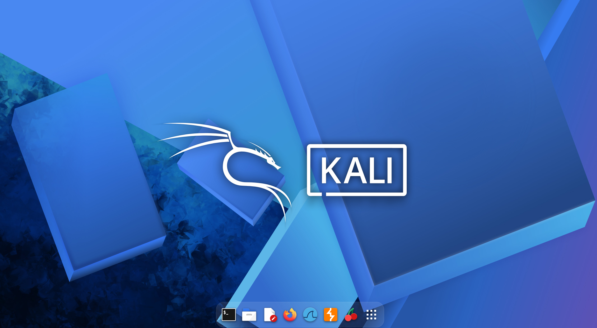
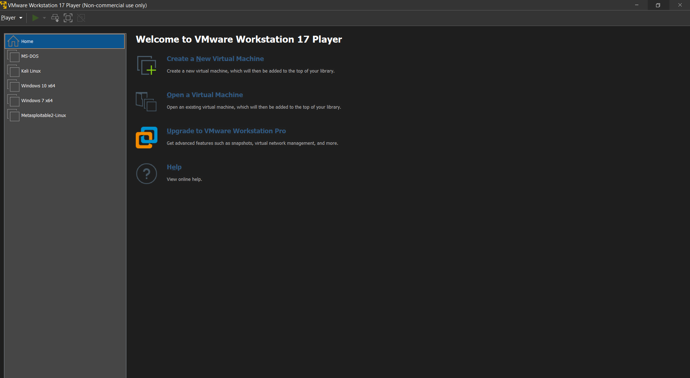
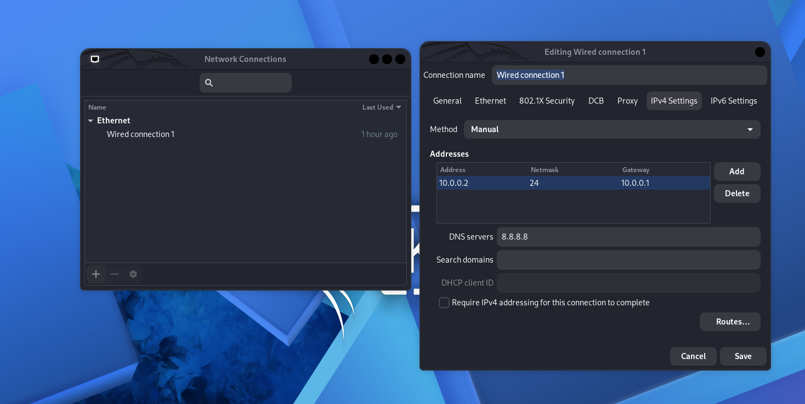
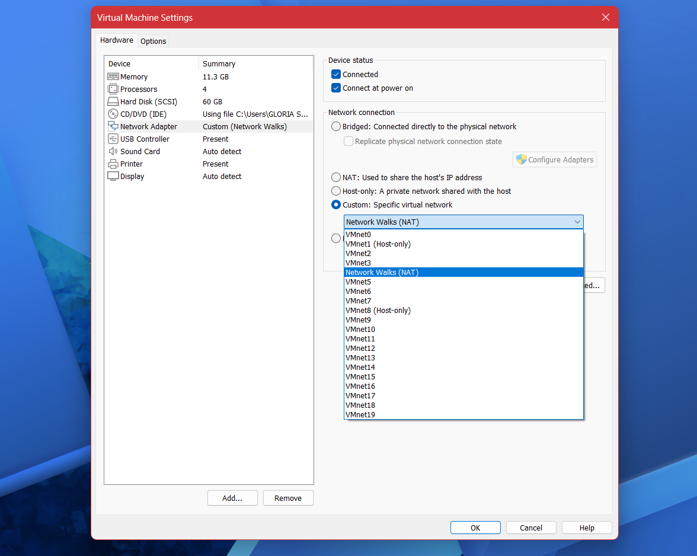
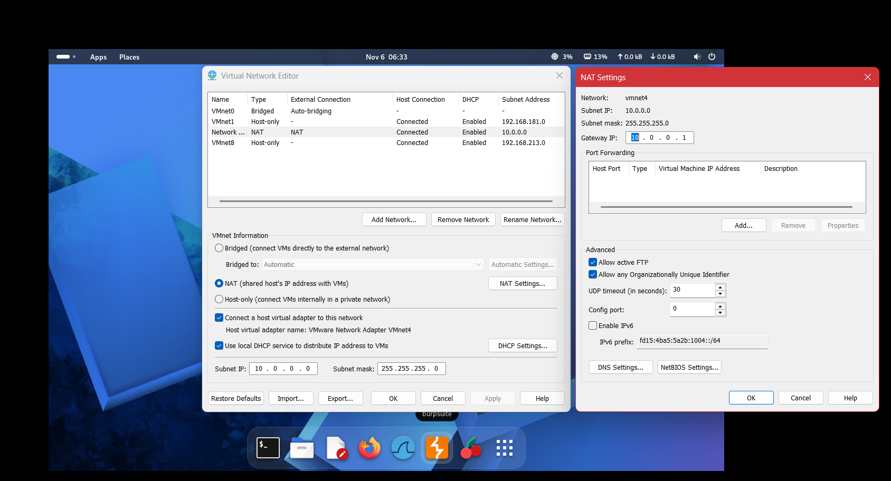
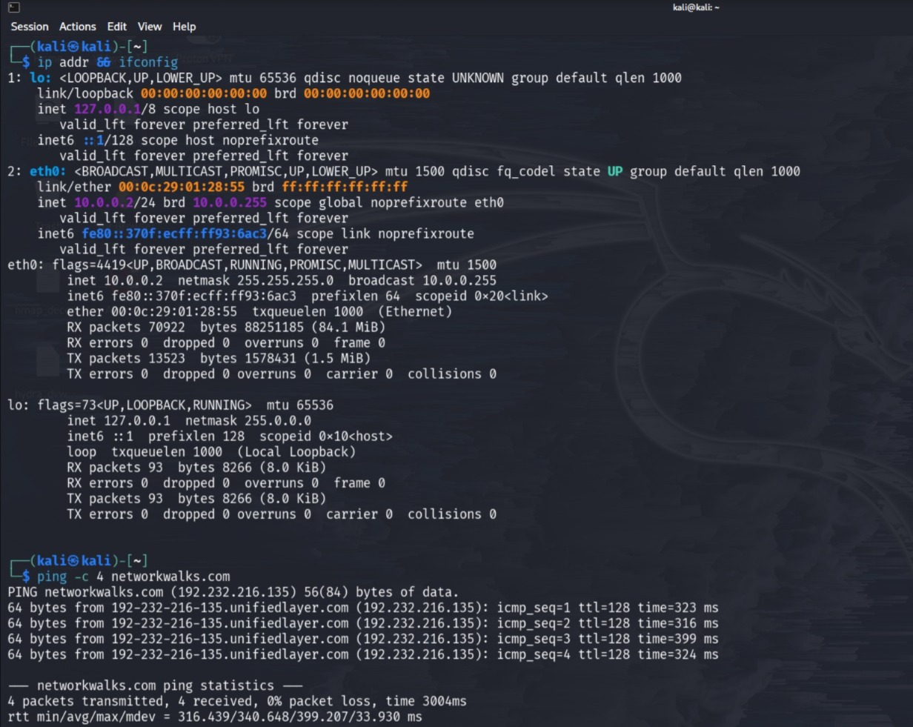

<div align="center">

# 🛡️ Cybersecurity Lab Environment Setup

### Building a Kali Linux Virtual Lab on VMware Workstation 17 Player for Authorized Security Testing


**NetworkWalks Cybersecurity Program · Batch B084J · Week 01 · Project Module 1**

</div>

---

## 📖 Project Overview

This repository documents **Project Module 1 – Cybersecurity Lab Setup** from Week 1 of my **NetworkWalks Cybersecurity Internship (Batch B084J)**.

I built an isolated virtual lab on a **Windows 11** host using **VMware Workstation 17 Player**, with **Kali Linux** as the security operating system. The VM sits on a custom NAT network (**VMnet8**) using the **10.0.0.0/24** subnet, with a static IPv4 address, gateway and DNS server.

| | |
|---|---|
| 👩‍💻 **Author** | Gloria Shruti |
| 🏫 **Program** | NetworkWalks Cybersecurity Program |
| 🎓 **Batch** | B084J |
| 📅 **Week / Module** | Week 01 – Project Module 1 |


*Figure 1 – Kali Linux desktop running inside the virtual lab.*

---

## 🎯 Project Objectives

- ✅ Install and configure **VMware Workstation 17 Player** on a Windows 11 host
- ✅ Set up a **Kali Linux** virtual machine
- ✅ Configure a custom NAT network (**VMnet8**) with the **10.0.0.0/24** subnet
- ✅ Assign Kali a static IPv4 address (**10.0.0.2/24**) with gateway **10.0.0.1** and DNS **8.8.8.8**
- ✅ Verify network connectivity and DNS resolution
- ✅ Build a foundation for authorized penetration-testing practice

---

## 🧪 Purpose of the Lab

This lab gives me a safe, isolated place to learn cybersecurity tools and techniques without touching production systems or networks I don't own.

- 🔐 Practice security tools in a controlled environment
- 🌐 Understand virtual networking (NAT, subnets, gateways, DNS)
- 🧰 Prepare for later internship modules and authorized testing exercises
- ♻️ Keep the host machine separate from security tooling

> ⚠️ **Educational use only.** This lab is for learning and for **authorized** security testing.

---

## 🏗️ Lab Architecture

```text
┌──────────────────────────────────────────────────────────┐
│              Host: Windows 11                            │
│     VMware Workstation 17 Player                         │
│                                                          │
│   ┌──────────────────────────────────────────────┐       │
│   │  Custom NAT Network – VMnet8                 │       │
│   │  Network: 10.0.0.0/24                        │       │
│   │  Gateway: 10.0.0.1     DNS: 8.8.8.8          │       │
│   │                                              │       │
│   │      ┌─────────────────────────┐             │       │
│   │      │  Kali Linux VM          │             │       │
│   │      │  IP: 10.0.0.2/24        │             │       │
│   │      └─────────────────────────┘             │       │
│   └──────────────────────┬───────────────────────┘       │
└──────────────────────────┼───────────────────────────────┘
                           │  NAT
                           ▼
                  Host network / Internet
```


*Figure 2 – VMware Workstation 17 Player with the Kali Linux virtual machine.*

---

## ⚙️ Lab Configuration

| Component | Configuration |
|---|---|
| Hypervisor | VMware Workstation 17 Player |
| Host OS | Windows 11 |
| Security VM | Kali Linux |
| Virtual Network | Custom NAT – VMnet8 |
| Network Address | 10.0.0.0/24 |
| Kali Linux IP | 10.0.0.2/24 |
| Subnet Mask | 255.255.255.0 |
| Default Gateway | 10.0.0.1 |
| DNS Server | 8.8.8.8 |

<!-- TODO: Compare this table with screenshots 03, 04 and 06 before publishing. If a screenshot shows a different value or network name, note the difference in the README rather than changing the evidence. -->

---

## 🧰 Prerequisites and Tools Used

| Tool / Requirement | Purpose |
|---|---|
| 💻 Windows 11 host | Host operating system |
| 🖥️ VMware Workstation 17 Player | Hypervisor for the virtual lab |
| 🐉 Kali Linux | Security-focused Linux distribution |
| 🌐 Custom NAT network (VMnet8) | Isolated lab network with internet access via NAT |
| ⌨️ Linux terminal | Network configuration and verification |

---

## 🚀 Step-by-Step Lab Setup Procedure

### 1️⃣ VMware Workstation 17 Player Setup

1. Install VMware Workstation 17 Player on the Windows 11 host.
2. Launch VMware and confirm the application opens correctly.

### 2️⃣ Kali Linux VM Setup / Import

1. Obtain Kali Linux for VMware from the official Kali website.
2. Open or import the Kali VM in VMware Workstation 17 Player.
3. Power on the VM and confirm it boots to the desktop (see Figure 1).

### 3️⃣ Custom NAT Network (VMnet8) Configuration

1. Use **VMnet8** (NAT) as the lab network.
2. Configure the lab subnet as **10.0.0.0/24** with gateway **10.0.0.1**.


*Figure 3 – VMware network settings for the lab.*

<!-- TODO: Check screenshot 06. If it shows VMnet2 or another identifier, add a note about it here instead of claiming it proves VMnet8. -->

### 4️⃣ Kali Linux Network Adapter Configuration

1. Open the Kali VM's network settings.
2. Connect the adapter to the lab network.


*Figure 4 – Kali Linux network adapter and connection settings.*

### 5️⃣ Static IPv4 Configuration

Set the following on the Kali network connection:

| Setting | Value |
|---|---|
| Method | Manual |
| Address | 10.0.0.2 |
| Netmask | 255.255.255.0 (/24) |
| Gateway | 10.0.0.1 |
| DNS | 8.8.8.8 |


*Figure 5 – Kali Linux IP configuration.*

### 6️⃣ Network Connectivity and DNS Verification

Connectivity testing is covered in the verification section below.


*Figure 6 – Connectivity test run from the Kali Linux terminal.*

### 7️⃣ Clean VM Snapshot / Recovery Point

No snapshot or recovery point is documented for this module, so none is claimed here.

---

## ✅ Lab Verification

| # | Command | What It Verifies | Status |
|---|---|---|---|
| 1 | `ip addr` | Kali has IP 10.0.0.2/24 on its interface | 🔎 Confirm against Figure 5 |
| 2 | `ip route` | Default route points to 10.0.0.1 | 🧪 Recommended |
| 3 | `ping -c 4 10.0.0.1` | Reachability of the gateway | 🧪 Recommended |
| 4 | `ping -c 4 8.8.8.8` | Internet reachability without DNS | 🔎 Confirm against Figure 6 |
| 5 | `ping -c 4 networkwalks.com` | DNS resolution plus reachability | 🧪 Recommended |

```bash
ip addr
ip route
ping -c 4 10.0.0.1
ping -c 4 8.8.8.8
ping -c 4 networkwalks.com
```

**Legend:** 🔎 shown in the screenshots, so check the output there · 🧪 recommended for additional verification.

> ℹ️ A website may not answer ping (ICMP) even when it is reachable in a browser. If `ping networkwalks.com` fails, check whether the name resolves and whether the IP ping succeeds before concluding there is a DNS or connectivity problem.

<!-- TODO: Replace the Status column with actual results (e.g. "✅ 4/4 replies") only for commands whose output you can see in your screenshots. -->

---

## 🎬 Project Demonstration Video

The video below shows my completed lab setup.

[](https://www.linkedin.com/feed/update/urn:li:activity:7524502033136087040/)

🔗 https://www.linkedin.com/feed/update/urn:li:activity:7524502033136087040/

> The video is hosted on LinkedIn and opens there. GitHub README files can't reliably play video inline in every view.

---

## 🧩 Problems Encountered and Solutions

No specific problems are documented for this module. Points worth checking in a setup like this:

| Area | What to Check |
|---|---|
| Network name | The adapter and network name should match **VMnet8** in the VMware settings |
| IP settings | Address, netmask, gateway and DNS should match the configuration table |
| Connectivity | Test the gateway first, then an IP address, then a domain name |

---

## 📚 What I Learned

- How to set up a virtual lab with VMware Workstation 17 Player
- How NAT networking works for a VM, and how subnets, gateways and DNS fit together
- How to assign and verify a static IPv4 configuration on Kali Linux
- How to use `ip addr`, `ip route` and `ping` to check network health
- Why an isolated lab matters for safe, ethical security practice

---

## 🔒 Security and Ethical Use

- This lab is for **education and authorized security testing only**.
- Only test systems and networks that you own or have **explicit written permission** to test.
- Never use these tools against third-party systems without authorization.
- Keep the lab isolated from production environments.

---

## 🔗 Tools and Resources

| Resource | Link |
|---|---|
| VMware Workstation | https://www.vmware.com/products/desktop-hypervisor/workstation-and-fusion |
| Kali Linux | https://www.kali.org/ |
| Kali Linux Downloads | https://www.kali.org/get-kali/ |
| Kali Linux Documentation | https://www.kali.org/docs/ |
| NetworkWalks | https://networkwalks.com |

---

## 👩‍💻 Author

**Gloria Shruti**
NetworkWalks Cybersecurity Program · Batch B084J

[](https://github.com/Gloria-1302/)
[](https://www.linkedin.com/in/gloria-shruti-3201b1223/)

---

## 📋 Project Information

| Field | Details |
|---|---|
| Project Title | Cybersecurity Lab Environment Setup |
| Program | NetworkWalks Cybersecurity Program |
| Batch | B084J |
| Week | 01 |
| Module | Project Module 1 – Cybersecurity Lab Setup |
| Repository | [NETWORKWALKS-B084J-WK1-PM1-CYBERSECURITY-LAB-SETUP](https://github.com/Gloria-1302/NETWORKWALKS-B084J-WK1-PM1-CYBERSECURITY-LAB-SETUP) |

<div align="center">

⭐ *Built for learning. Used responsibly.* ⭐

</div>
